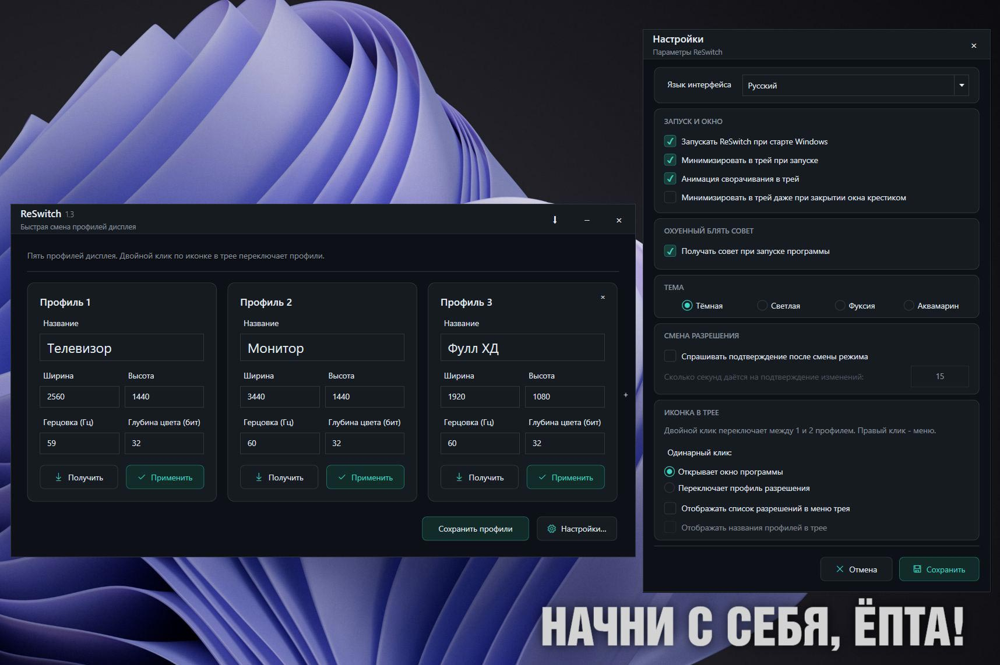

# ReSwitch

**English** · [Русский](#русский)

A desktop app for **Windows** on **.NET 6** (WPF): quick **screen resolution** switching with saved profiles, works from the **system tray**, with flexible window behavior settings. It can also show a tip of the day.



## Download

**Download and run [ReSwitch.exe](https://github.com/dinosmike/ReSwitch/releases/tag/ReSwitch_1_4) (version 1.4)**

## Main features

### Display profiles

- Up to **5 profiles** (at least **2**): each has a **name**, **width**, **height**, **Hz** and **bits per pixel**.
- Buttons on a profile card: apply the mode, take the current parameters from Windows, delete the profile (when allowed).
- All profiles and settings are **saved** to **`Re_settings.json`** in `%LocalAppData%\ReSwitch`.
- **Quick resolution pick**: right-click the "Width" / "Height" fields for a list of popular resolutions.

### Switching the mode

- Before switching, the app **checks** that the chosen mode is **supported** by the display.
- Optional **confirmation with a countdown**: after the switch a dialog appears; if you don't confirm in time, the previous mode is **restored** (set in the display mode section).

### Tip of the day

- When enabled — **short random tips** from an external API. Shown **on startup** or with **Ask for a tip** in the tray menu.

### Tray and startup

- **Notification area** icon: open the window, **settings**, **exit**; with tips enabled — an item to ask for a tip.
- **Single instance**: launching again **activates** the already open window.
- Configurable: **autostart** with Windows, **minimize to tray** on close / on start, tray **animation**.
- Configurable **single click** on the tray icon (for example, open the window or switch resolution).
- The tray menu can list **all profiles** for quick switching and show their **names** and/or just the resolution.

### Interface

- **Themes** (Dark, Light, Fuchsia, Aquamarine).
- Interface **localization** (strings in JSON).
- Custom **title bar** (drag, minimize, to tray, close).

## Building

Requires **.NET SDK 6** (or compatible with `net6.0-windows`).

```bash
dotnet build ReSwitch/ReSwitch.csproj -c Release
```

The executable will be in `ReSwitch\bin\Release\net6.0-windows\` (or in a RID subfolder when publishing with `--runtime`).

## Technologies

- **WPF** + **Windows Forms** (tray `NotifyIcon`).
- System APIs for changing display settings (`DisplaySettingsService` and related logic).

---

## Русский

Настольное приложение для **Windows** на **.NET 6** (WPF): быстрое переключение **разрешения экрана**, работа из **системного трея** и гибкие настройки поведения окна. А также может показывать совет дня.

## Запуск

**Скачать и запустить [ReSwitch.exe](https://github.com/dinosmike/ReSwitch/releases/tag/ReSwitch_1_4) (версия 1.4)**

## Основной функционал

### Профили дисплея

- До **5 профилей** (минимум **2**): у каждого задаются **имя**, **ширина**, **высота**, **Гц**, **бит на пиксель**.
- Кнопки на карточке профиля: применить режим, взять текущие параметры из Windows, удалить профиль (если разрешено).
- **Сохранение** всех профилей и настроек в файл **`Re_settings.json`** в каталоге `%LocalAppData%\ReSwitch`.
- **Быстрый выбор разрешения**: контекстное меню по полям «Ширина» / «Высота» (ПКМ) — список популярных разрешений.

### Переключение режима

- Перед сменой режима выполняется **проверка**, что выбранный режим **доступен** дисплею.
- Опционально — **подтверждение с таймером**: после смены показывается диалог; если не подтвердить вовремя, выполняется **откат** к предыдущему режиму (настраивается в разделе режима отображения).

### Совет дня

- При включённой функции — **случайные короткие советы**, получаемые через внешний API. Показ совета **при запуске** или через **Попросить совет** в меню трея.

### Трей и запуск

- Иконка в **области уведомлений**: открыть окно, **настройки**, **выход**; при включённых советах — пункт запроса совета.
- **Один экземпляр** приложения: повторный запуск **активирует** уже открытое окно.
- Настраивается: **автозагрузка** с Windows, **сворачивание в трей** при закрытии крестиком / при старте, **анимация** ухода окна в трей.
- Настраиваемое поведение **одиночного клика** по иконке трея (например, открыть окно или переключить разрешение).
- В меню трея можно показать **список всех профилей** для быстрого переключения и отображать **имена** и/или только разрешение.

### Интерфейс

- **Темы оформления** (Тёмная, Светлая, Фуксия, Аквамарин).
- **Локализация** интерфейса (строки в JSON).
- Кастомная **заголовочная панель** (перетаскивание, свернуть, в трей, закрыть).

## Сборка

Требуется установленный **.NET SDK 6** (или совместимый для `net6.0-windows`).

```bash
dotnet build ReSwitch/ReSwitch.csproj -c Release
```

Готовый исполняемый файл будет в `ReSwitch\bin\Release\net6.0-windows\` (или в подпапке RID при публикации с `--runtime`).

## Технологии

- **WPF** + **Windows Forms** (трей `NotifyIcon`).
- Системные API для смены параметров дисплея (`DisplaySettingsService` и связанная логика).
